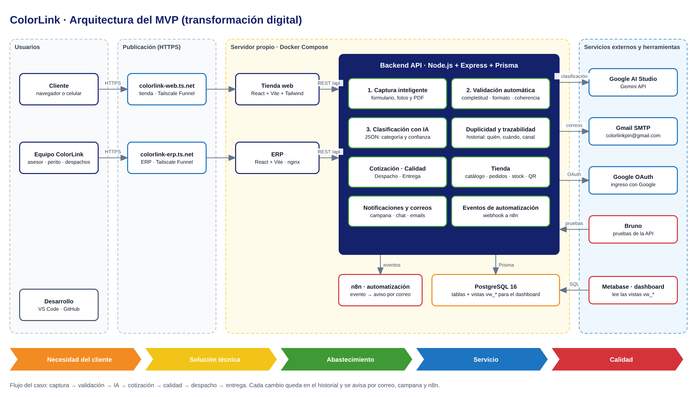

# ColorLink · Ecosistema tecnológico

Cómo cubre el proyecto cada herramienta del ecosistema del semestre, y cómo usar las que son opcionales.
Principio del curso: *cada herramienta tiene un propósito dentro de la arquitectura; ninguna herramienta es "la transformación".*



El diagrama editable está en [`arquitectura.drawio`](arquitectura.drawio). Se abre en https://app.diagrams.net con **Archivo → Abrir desde → Dispositivo**.

## Herramienta por herramienta

| Lámina | En ColorLink | Para qué se usa |
|---|---|---|
| **IA**: Google AI Studio / Gemini API | Gemini API (`/api/classify-project`, asistente virtual) | Clasifica la necesidad y devuelve JSON con categoría, condición, complejidad y confianza. También lee el texto de las fotos y los PDF. |
| **Base de datos**: Supabase PostgreSQL | PostgreSQL 16 en Docker | Es el mismo motor que usa Supabase. Para pasar a Supabase basta con cambiar `DATABASE_URL`; las migraciones se aplican solas al arrancar. |
| **Backend**: FastAPI | Node.js + Express + Prisma | Hace el mismo papel (API REST). Se eligió Node para compartir las reglas de validación entre servidor y tienda (`src/shared/`), que están escritas en TypeScript. |
| **Frontend**: Streamlit | React + Vite (tienda y ERP) | Una tienda pública y un ERP por roles necesitan más control de la interfaz del que da Streamlit. |
| **Automatización**: n8n / Activepieces | n8n (servicio opcional) + eventos del backend | El backend envía eventos a un webhook y n8n decide a quién avisar. Ver abajo. |
| **Dashboard**: Metabase / Looker Studio | Metabase (servicio opcional) + vistas SQL `vw_*` | Indicadores de proyectos, calidad del dato, tiempos del flujo, ventas e inventario. Ver abajo. |
| **APIs**: Bruno | Colección en `api/bruno/` | 21 solicitudes con pruebas automáticas de captura, validación, IA y flujo completo. |
| **Arquitectura**: diagrams.net | `docs/arquitectura.drawio` | Diagrama de componentes y del flujo del caso. |
| **Desarrollo**: VS Code | — | Editor del proyecto. |
| **Repositorio**: GitHub | `Nolo-20/ColorLink` y `Nolo-20/ColorLink---ERP` | Código de la tienda + backend y del ERP. |

## Los 3 entregables del MVP

| Entregable | Dónde está |
|---|---|
| **1. Captura inteligente** | Formularios "Crear nuevo proyecto" y "Nueva cotización con IA". Piden identificación, ciudad, tipo de proyecto, área, superficie, ambiente, estado de la superficie, colores, fecha requerida, descripción, fotos o PDF y autorización de datos. El proyecto queda con ID único, canal de origen e historial desde el primer momento. |
| **2. Validación automática** | `src/shared/validacionProyecto.ts`: las mismas reglas corren en el servidor y en el formulario. Revisa completitud, formato (rangos y valores permitidos), coherencia (avisos como "área inusual para una vivienda"), duplicidad (`/api/projects/check-duplicates`) y trazabilidad (`estado_proyecto_historial`). |
| **3. Clasificación con IA** | Gemini devuelve un JSON con `categoria`, `diagnostico_patologia`, `severidad`, `complejidad`, `nivel_confianza_ia_pct` y `texto_extraido`. El servidor guarda la respuesta completa en `diagnostico_ia.resultado_ia`. Si la IA no está disponible, se clasifica por reglas y así queda marcado. |

## Automatización con n8n

**Eventos que envía el backend** (solo si `AUTOMATIZACION_WEBHOOK_URL` está configurado):

| Evento | Cuándo |
|---|---|
| `proyecto.creado` | Un cliente registra un proyecto. Incluye completitud, avisos, posibles duplicados y clasificación IA. |
| `proyecto.estado_cambiado` | Cotizado, revisión técnica, aprobado, rechazado, despachado, entregado o cancelado. |
| `pedido.creado` / `pedido.estado_cambiado` | Compras de la tienda. |
| `inventario.stock_bajo` | Una presentación queda con menos de 10 unidades después de una venta. |

**Puesta en marcha (en el servidor):**

1. En `~/ColorLink/.env` agrega:
   ```
   AUTOMATIZACION_WEBHOOK_URL=http://n8n:5678/webhook/colorlink
   AUTOMATIZACION_TOKEN=una-clave-larga-que-inventes
   COLORLINK_EQUIPO_EMAIL=colorlinkpin@gmail.com
   ```
2. Arranca n8n y reinicia la tienda:
   ```
   docker compose --profile automatizacion up -d n8n
   docker compose up -d colorlink
   ```
3. Entra a `http://<ip-del-servidor>:5678` y crea la cuenta de administrador de n8n.
4. Ve a **Workflows → Import from File** y elige `automatizacion/n8n-colorlink-avisos.json`.
5. En el nodo **Enviar correo al equipo**, crea la credencial **SMTP** con estos datos:
   - Host `smtp.gmail.com`, puerto `465`, SSL activado.
   - Usuario `colorlinkpin@gmail.com` y la contraseña de aplicación.
6. Activa el flujo con el interruptor **Active**.

El flujo hace tres cosas:
- Valida el token.
- Decide el aviso:
  - proyecto nuevo → equipo. Si tiene avisos, posible duplicado o la IA pide visita, el asunto dice **"⚠️ Revisar"**.
  - aprobado por calidad → despachos.
  - rechazado → equipo.
  - entregado → equipo.
  - stock bajo → compras.
- Envía el correo.

La lógica está también en `automatizacion/decidir-aviso.js` para leerla con calma.

## Dashboard con Metabase

1. Arranca Metabase:
   ```
   docker compose --profile dashboard up -d metabase
   ```
2. Entra a `http://<ip-del-servidor>:3001`, crea la cuenta y agrega la base de datos con estos datos:
   - Tipo: PostgreSQL
   - Host: `db`, puerto `5432`
   - Base: `colorlink_db`, usuario `colorlink_user`, con la contraseña de `POSTGRES_PASSWORD`
3. Las vistas listas para graficar:

| Vista | Pregunta que responde |
|---|---|
| `vw_pipeline` | ¿Cuántos proyectos hay en cada estado y cuánto suman? |
| `vw_proyectos` | Detalle por proyecto: ciudad, tipo, área, completitud, avisos, categoría IA, confianza, calidad, total cotizado, asesor. |
| `vw_calidad_dato` | Por mes: completitud promedio, % con avisos, % posibles duplicados, % con evidencias, % clasificados con IA. |
| `vw_tiempos_proyecto` | Horas desde la creación hasta cotizado, aprobado, despachado y entregado. |
| `vw_ventas_diarias` | Pedidos, ventas y ticket promedio por día y tipo de entrega. |
| `vw_ventas_producto` | Productos y presentaciones más vendidos. |
| `vw_inventario` | Unidades por presentación y bodega, con alerta de stock bajo. |

Dashboard sugerido:
- Embudo con `vw_pipeline`.
- Línea de completitud con `vw_calidad_dato`.
- Barras de horas promedio por etapa con `vw_tiempos_proyecto`.
- Ventas por día con `vw_ventas_diarias`.
- Tabla de stock bajo con `vw_inventario` filtrando `stock_bajo = true`.

Para Looker Studio sirven las mismas vistas, con el conector de PostgreSQL. Eso requiere que la base sea accesible desde internet (por ejemplo, en Supabase).

## Pruebas de la API con Bruno

1. Instala Bruno (https://www.usebruno.com) y elige **Open Collection** → carpeta `api/bruno`.
2. Elige el ambiente **Local** o **Servidor** y llena `email`/`password` (un cliente) y `emailStaff`/`passwordStaff` (un administrador o asesor).
3. Antes de correr **04 Proyectos (equipo)**, pon en **03 Cotizar proyecto** el `productoId` de un cuñete.
4. Ejecuta la colección completa: **Run** sobre la carpeta raíz.

Las pruebas comprueban esto:
- **Completitud:** un proyecto incompleto se rechaza con la lista de campos.
- **Formato:** área, fecha y superficie inválidas se rechazan.
- **Duplicidad:** el servidor devuelve coincidencias.
- **IA:** el JSON trae categoría, complejidad, confianza y texto extraído.
- **Flujo completo:** el proyecto se crea con trazabilidad, se cotiza, pasa por calidad, se despacha y termina **entregado**.

También se puede correr desde la terminal:
```
npx @usebruno/cli run -r --env Local --env-var email=... --env-var password=... --env-var emailStaff=... --env-var passwordStaff=...
```
